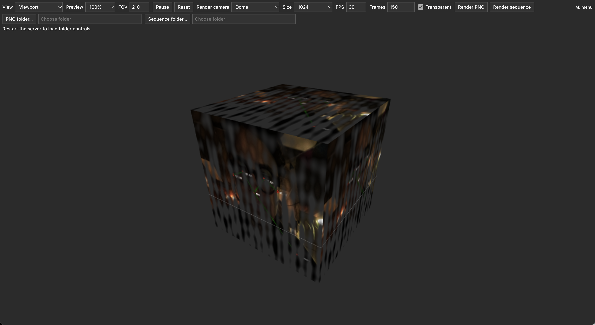

# DES7720_2026

[Lien vers le projet final]('https://annabmnn.github.io/DES7720_2026/projet_final/core/core.html')

## TO-DO LISTE
- [ ]  Mettre sur une branche le code des shaders dans le dôme

## 17/11/2026
Je suis contente de revenir à l'explorationde p5.js et du code créatif. 
J'ai très hâte d'expérimenter autour de plusieurs idées

### Idées de techniques à expérimenter pour le projet finals
+ Mediaquery css pour l'impression
+ Rendu dans le dome avec threejs
+ MIDI controller

### Idées de sentiments / thématique
+ frustration
   * écouteur qui marchent mal
   * quand un site ne charge pas 
   * problème de mot de passe oubliés
+ culpabilité
   * utilisation de l'IA
   * achat compulsif
   * scroll infini
+ le FOMO
+ ne rien faire comme résistance

Je n'ai pas encore trop d'idée pour les interaction : peut-être le clic, peut-être détecter certains choses à l'écran, peut-être le midi controller, peut-etre un niveau sonore. Je ne sais pas mais le thème va surement le définir.

## 20/11/2026
Mon plan secret à réussi.  
Hier j'ai eu la chance de tester mes visuels de shader dans le dome de la SAT avec un rendu en temps réel. C'était fou et ça me donne envie de tester plein de chose pour voir ce que ça donne dans la SAT.  
J'ai vu aussi des oeuvres web collaboratives dans le dome. Notamment un jeu en JS pour créer à plusieurs des constellations. Grâce à un code QR on se connecte au serveur, on calibre au début notre position dans le dome par le gyroscope, puis ensuite la différence entre la position de calibration et la position présente permet de faire bouger notre pointer dans l'espace. J'ai envie de réflechir à une expérience collaborative dans le dome. 
[ça fait longtemps que je gosse](https://no-fun.fun/) avec les shaders en glsl parce que je trouve ça marrant et j'aime partir de forme simple et travailler avec les contraintes de l'outil : écrire du code à la main et petit à petit tester et découvrir des nouveaux visuels. J'aimerais y ajouter un eprofondeur / un propos (meme si faire quelque que chose juste parce que c'est marrant ça peut aller comme un acte à contre courant face à l'hyper productivisme (dans lequel je baigne totalement)).
J'ai envie réflechir à une expérience pour ne rien faire collaborativement (interactivement). Penser à un minimum d'interaction ? Ou une interaction consciente et pensée ? 
(j'écris depuis un gueule de bois de trentenaire avec peu d'alcool, je rêve de rien faire et alimente en même temps ma to do list infini. Embrasser son paradoxe)
  
Représenter la to do liste infini ? 
 
### Inspi + Ressources 
+ [Ne rien faire au XXIe siecle](https://www.leslibraires.ca/livres/pour-une-resistance-oisive-ne-rien-jenny-odell-9782492596339.html?srsltid=AYCX9vK8zzbJjyM8zmJ8CAW9HvFcsn_j3_vcDpsOJrDQz3w6TUVRrpWn)
+ [Rien-o-thon à Nouvel Espace](https://www.instagram.com/p/DdoaY0JEZcL/?img_index=2)
+ [Se reposer c'est lutter](https://www.arteradio.com/son/se-reposer-c-est-lutter)
 
Retrouver la source qui dit qu'avec le capitalisme on est devenu notre propre manager intégré
Question aussi du privilège ? Qui peut se permettre de rien faire ? Au détriment de qui l'on peut ne rien faire ?
 
Explorer aussi la question de prendre l'espace ? J'ai failli me dégonfler hier parce que les autres personnes montrer des choses incroyable puis j'avais peur d'etre ridicule techniquement 

<video src="./assets/video/20261119/1_compressed.mp4"  height="500" controls></video>
<video src="./assets/video/20261119/2_compressed.mp4"  height="500" controls></video>

## 23/11/2026

Je me sens un peu submergée par l'ensemble des possibilités et des thèmes à explorer. 
Je vais commencer par une idée technique puis voir ce qu'il se passe.  
Je vais commencer par mettre le code pour faire le rendu dans le dome, puis ajouter du body detector pour le projeter.
----
Fin de la session : je suis contente d'avoir déjà réussi à intégrer Tensorflow + une structure qui fonctionne. La prochaine étape ça va etre d'utiliser ce canvas comme une texture pour mon matériel et de le passer en uniform à mon shader.
Je dois ensuite réflechir au contexte dans le dome à la SAT : dans un contexte de fête, ce qui est lourd c'est trop de lumière, trop de téléphone. L'impression d'être dans instagram.
Utiliser ml5 object détection pour détecter les téléphones. Plus il y a de téléphone plus il y a de la lumière ? Le son diminue ? Là où se trouve le téléphone cela agit comme un masque ? 
  Si un téléphone est détecté on affiche la tête de la personne la plus proche ? 

  La discussion avec un ami me fait réaliser que la fraction est plus grande lorsque que l'on part d'une interface avec un fonctionnement que l'on connait, vis à vis duquel on a des attentes.

## Suite des tests
J'ai mis en place les textures passer en uniforms dans le shader. C'est nice mais je pense qu'il faudrait mieux que je donne les points du corps pour orienter la déformation.
</img>

J'ai réalisé qu'avoir les points du corps à converitr en shader allait etre un enfer de calcul. Autant rester avec une texture transitoire, en laissant seulement les points du corps. 
<video src="./assets/video/20261123/01.mp4"  height="500" controls></video>

## 26/11/2026

### Object detection
J'ai reflechi aux frictions lorsque l'on danse dans le dome 
+ trop de lumière
+ trop de personnes sur leur téléphone
+ impression d'être DANS instagram

Je veux donc essayer en utilisant la librairie de détection d'objet de tensorflow de détecter les téléphones.
Lorsqu'ils sont détécter, ils ouvriraient des fenetres vers des motifs super lumineux (masque)(motif ou instagram ?) qui ajouterait de la lumière à l'espace de danse.
#### Etapes 1
J'ai mis en place un premier set up de détéction d'objet en utilisant tensor flow et [ce tutoriel](https://codelabs.developers.google.com/codelabs/tensorflowjs-object-detection#4). Il marche bien mais le dessin est fait en html et non dans le canvas. 
Dessiner les boudings box des téléphones dans un canvas va être ma prochaine étape. 

<video src="./assets/video/20261126/01.mp4"  height="500" controls></video>

Dans les tests on remarque aussi que le test jump, il faudra encore laisser un délai pour qu eça ne jump pas

#### Etapes 2

J'ai mis en place le mask avec un channel de ouleur pour les objets et un channel pour les pour les persons. Cela fonctionne techniquement mais la détection du téléphone n'est pas vraiment satisfaisante. Il faudrait réflechir à détecter autre chose (des verres ?) ou changer d'idée 

<video src="./assets/video/20261126/02.mp4"  height="500" controls></video>